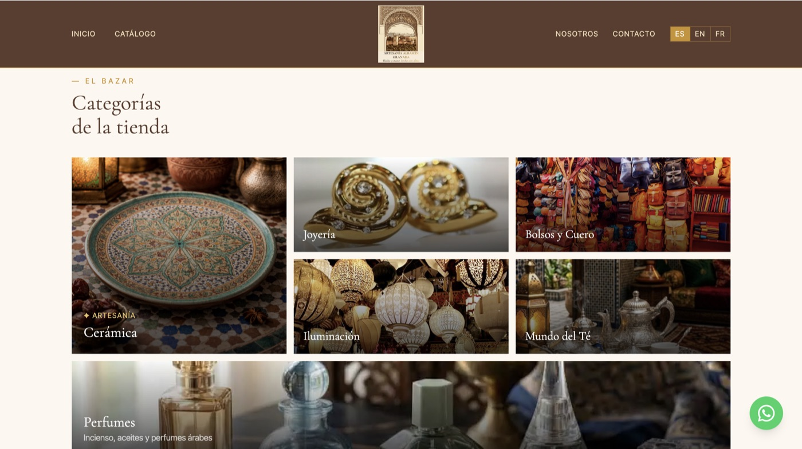
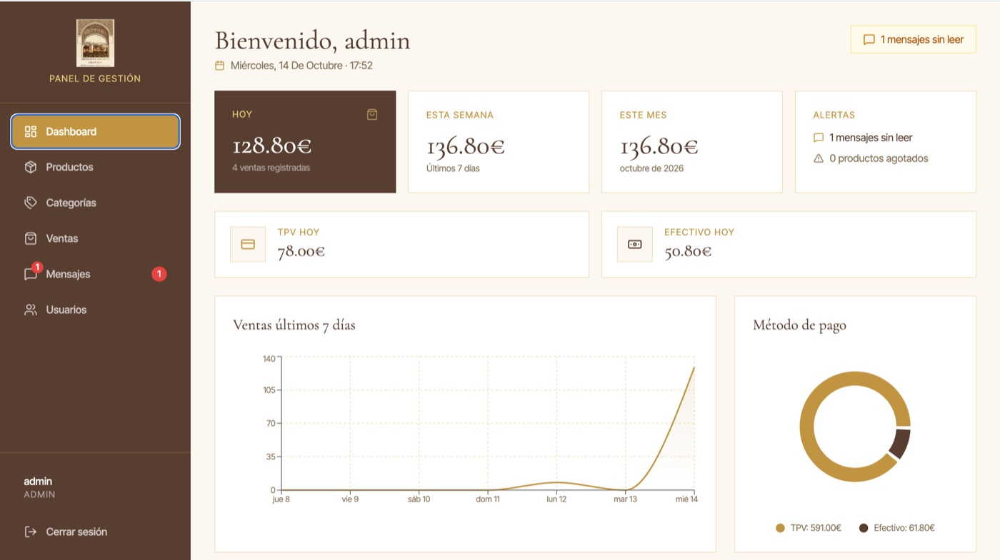
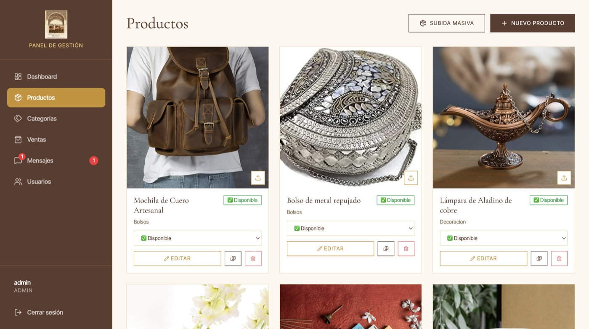

# 🏺 Artesanía Albaicín — Sistema de Gestión

🌐 [English](README.md) · **Español**

Aplicación full stack para una tienda de artesanía del Albaicín (Granada). Tiene tres partes: una **web pública** para turistas, un **panel de administración** para el personal de la tienda y una **API REST** que conecta ambos.

> **Estado:** proyecto funcional, aún sin desplegar. Consulta la [hoja de ruta](#hoja-de-ruta).

## Capturas

| Web pública | Categorías de la tienda |
|:-:|:-:|
|  |  |

| Dashboard del panel | Gestión de productos |
|:-:|:-:|
|  |  |

## Funcionalidades

**Web pública**
- Catálogo de productos filtrable por categoría, con página de detalle.
- Formulario de contacto que guarda los mensajes en la base de datos.
- Disponible en español, inglés y francés, con animaciones (AOS), metadatos SEO y diseño adaptable a móvil.

**Panel de administración**
- Inicio de sesión con acceso por roles (`admin`, `encargado` y `empleado`).
- Gestión de productos, categorías e imágenes (almacenadas en Cloudinary).
- Registro diario de ventas con método de pago (tarjeta/efectivo) y descuentos.
- Dashboard con gráficos de ventas y contadores (mensajes sin leer, productos agotados).
- Bandeja de mensajes de contacto.

**API**
- Autenticación con JWT y contraseñas cifradas con bcrypt.
- Validación de datos con Pydantic (roles, métodos de pago o importes negativos inválidos se rechazan con un 422).
- Copias de seguridad automáticas de SQLite (al arrancar y cada día a medianoche, conservando las 7 últimas) con la API de backup de SQLite.
- Subida de imágenes limitada a JPG, PNG y WEBP de hasta 5 MB.
- Documentación interactiva generada por FastAPI en `/docs`.

## Tecnologías

| Parte | Tecnologías |
|---|---|
| **Backend** | Python, FastAPI, SQLAlchemy 2, SQLite, Pydantic v2, JWT (python-jose), bcrypt, Cloudinary, APScheduler, Uvicorn |
| **Web pública** | React 19, TypeScript, Vite, Tailwind CSS 4, TanStack Query, React Router, Axios, AOS, React Helmet |
| **Panel de administración** | React 19, TypeScript, Vite, Tailwind CSS 4, TanStack Query, React Router, Axios, Recharts |

## Estructura del proyecto

```
artesania-albaicin-personal/
├── backend/     API con FastAPI          → http://localhost:8000
├── frontend/    Web pública              → http://localhost:5173
└── panel/       Panel de administración  → http://localhost:5174
```

## Puesta en marcha

### Requisitos
- Python 3.14 (la versión usada en el desarrollo)
- Node.js 24 (la versión usada en el desarrollo) y npm
- Una cuenta gratuita de [Cloudinary](https://cloudinary.com) para guardar las imágenes

### 1. Clonar el repositorio
```bash
git clone https://github.com/ZakariaeBouhaba/artesania-albaicin-personal.git
cd artesania-albaicin-personal
```

### 2. Backend
```bash
cd backend
python3 -m venv venv
source venv/bin/activate        # En Windows: venv\Scripts\activate
pip install -r requirements.txt
```

Crea un archivo `.env` dentro de `backend/` (Git lo ignora):

```env
SECRET_KEY=<genera una, ver abajo>
ALGORITHM=HS256
ACCESS_TOKEN_EXPIRE_MINUTES=480
CLOUDINARY_CLOUD_NAME=<tu cloud name>
CLOUDINARY_API_KEY=<tu api key>
CLOUDINARY_API_SECRET=<tu api secret>
```

Genera una clave secreta segura con:
```bash
python3 -c "import secrets; print(secrets.token_hex(32))"
```

Crea el primer administrador (el script pide email y contraseña por teclado, no se guarda nada en el código):
```bash
python3 crear_admin.py
```

Arranca la API:
```bash
python3 main.py
```
El archivo de base de datos (`artesania.db`) se crea solo la primera vez.

### 3. Web pública
```bash
cd frontend
npm install
npm run dev
```

### 4. Panel de administración
```bash
cd panel
npm install
npm run dev
```

| Servicio | URL |
|---|---|
| Web pública | http://localhost:5173 |
| Panel de administración | http://localhost:5174 |
| API | http://localhost:8000 |
| Documentación de la API | http://localhost:8000/docs |

## Roles y permisos

Hay tres roles: `admin`, `encargado` y `empleado`.

| Acción | Público | Empleado | Encargado | Admin |
|---|:-:|:-:|:-:|:-:|
| Ver productos, categorías e imágenes | ✅ | ✅ | ✅ | ✅ |
| Enviar un mensaje de contacto | ✅ | ✅ | ✅ | ✅ |
| Registrar, listar y ver ventas | ❌ | ✅ | ✅ | ✅ |
| Ver estadísticas | ❌ | ✅ | ✅ | ✅ |
| Cambiar el estado de un producto | ❌ | ✅ | ✅ | ✅ |
| Crear / editar / eliminar productos, categorías e imágenes | ❌ | ❌ | ✅ | ✅ |
| Eliminar ventas | ❌ | ❌ | ✅ | ✅ |
| Leer, marcar y borrar mensajes de contacto | ❌ | ❌ | ✅ | ✅ |
| Crear usuarios y lanzar copias de seguridad manuales | ❌ | ❌ | ❌ | ✅ |

## Endpoints de la API

La documentación interactiva completa está en `/docs`.

| Recurso | Endpoints | Acceso |
|---|---|---|
| Autenticación | `POST /auth/login` | Público |
| | `POST /auth/crear-usuario` | Admin |
| Productos | `GET /productos/`, `GET /productos/{id}` | Público |
| | `PATCH /productos/{id}/estado` | Cualquier usuario con sesión |
| | `POST /productos/`, `PUT /productos/{id}`, `DELETE /productos/{id}` | Encargado, Admin |
| Categorías | `GET /categorias/`, `GET /categorias/{id}` | Público |
| | `POST`, `PUT`, `DELETE` | Encargado, Admin |
| Imágenes | `GET /imagenes/{producto_id}` | Público |
| | `POST /imagenes/{producto_id}`, `DELETE /imagenes/{imagen_id}` | Encargado, Admin |
| Ventas | `GET /ventas/`, `GET /ventas/{id}`, `POST /ventas/` | Cualquier usuario con sesión |
| | `DELETE /ventas/{id}` | Encargado, Admin |
| Contacto | `POST /contacto/` | Público |
| | `GET /contacto/`, `GET /contacto/{id}`, `PATCH /contacto/{id}/leido`, `DELETE /contacto/{id}` | Encargado, Admin |
| Estadísticas | `GET /estadisticas/` | Cualquier usuario con sesión |
| Backup | `POST /backup` | Admin |

## Base de datos

SQLite con SQLAlchemy. Tablas: `usuarios`, `categorias`, `productos`, `imagenes_productos`, `mensajes`, `ventas`.

- Estado de un producto: `disponible`, `agotado`, `bajo_pedido`.
- Método de pago: `TPV` (tarjeta) o `Efectivo`.
- El total de una venta lo calcula el servidor (`precio_original − descuento`); nunca se fía del valor que envía el cliente.

> **Actualizar una base de datos antigua:** la tabla `imagenes_productos` tiene ahora una columna `public_id`. Si ya tienes una base de datos, añádela con
> `sqlite3 artesania.db "ALTER TABLE imagenes_productos ADD COLUMN public_id VARCHAR;"`

## Sobre el desarrollo

Este proyecto se desarrolló con asistencia de IA (Claude). Mi parte fue probar la API, revisar y corregir problemas (dependencias, permisos, validación de datos y gestión de imágenes), escribir la documentación y preparar el repositorio, mientras aprendía cómo funciona cada parte.

## Visión general del diseño

- **Tres aplicaciones separadas** en lugar de una: la web pública y el panel tienen usuarios y paquetes distintos y pueden desplegarse de forma independiente.
- **Autorización mediante dependencias** (`Depends(get_admin_user)`), de modo que cada ruta declara en su firma el rol que necesita.
- **Imágenes en Cloudinary** y no en el disco local, para que sobrevivan a los reinicios del servidor. Se guarda el `public_id` real en la base de datos para poder borrarlas con fiabilidad, también cuando se elimina un producto.
- **Validación en los esquemas** (`Literal`, `EmailStr`, `Field(ge=0)`) en vez de comprobaciones manuales con `if`: los datos inválidos no llegan a la lógica de negocio y las reglas aparecen solas en `/docs`.
- **Backups seguros** con la API de backup de SQLite en lugar de copiar el archivo, que puede dar una copia corrupta si se está escribiendo en la base de datos.

## Hoja de ruta

- [ ] Desplegar las tres aplicaciones (y pasar la base de datos a un volumen persistente o a PostgreSQL).
- [ ] Tests automáticos de la API (`pytest` + `TestClient` de FastAPI).
- [ ] Las estadísticas usan ahora hora UTC; pasarlas a la zona horaria `Europe/Madrid`.
- [ ] Límite de intentos en el login y en el formulario de contacto.
- [ ] Paginación en los listados de productos y ventas.
- [ ] Sustituir `python-jose` por `PyJWT` y actualizar patrones obsoletos de SQLAlchemy y Pydantic.
- [ ] Añadir productos y fotos reales, y cambiar el logo provisional.

## Autor

**Zakariae Bouhaba** — Estudiante de Desarrollo de Aplicaciones Web (Granada, España)

[LinkedIn](https://www.linkedin.com/in/zakariae-bouhaba-02472b3ba/) · [GitHub](https://github.com/ZakariaeBouhaba)